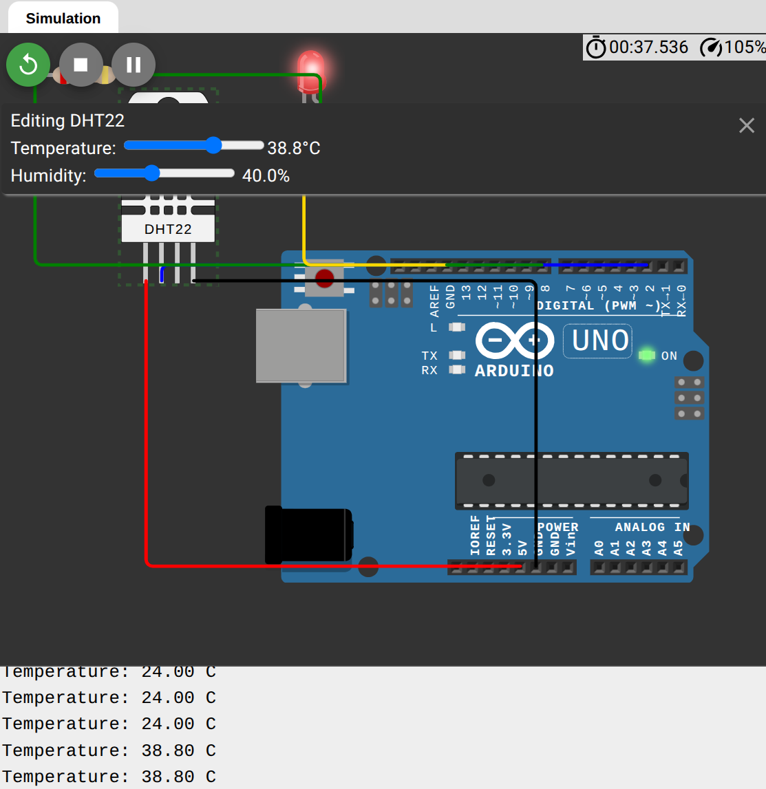

# Temperature Alert System

An Arduino Uno project, simulated in Wokwi, that reads the temperature from a DHT22 sensor and turns on an LED when it gets too hot.

## Live demo
[Open the project in Wokwi](https://wokwi.com/projects/478679892718055425)

## How it works
- The DHT22 sensor measures the temperature and sends it to Arduino pin 2.
- The Arduino prints the temperature to the serial monitor every 2 seconds.
- If the temperature is above 30 °C, the LED on pin 8 turns on. Otherwise it stays off.

## Components (simulated)
- Arduino Uno
- DHT22 temperature and humidity sensor
- LED
- 220 Ω resistor

## Circuit connections
| Part | Connects to |
|---|---|
| DHT22 VCC | 5V |
| DHT22 GND | GND |
| DHT22 SDA | Pin 2 |
| LED anode | Resistor, then pin 8 |
| LED cathode | GND |

## Demo

## What I learned
- Reading a sensor using the DHT library
- Controlling an output pin with digitalWrite
- Using an if-else condition for a threshold alert
- Using the serial monitor to check readings
